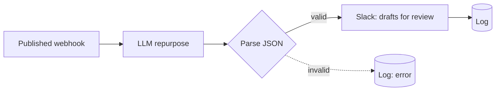

# AI Content Repurposer

> Publish one blog post, get a LinkedIn post, a Twitter/X thread, a newsletter blurb, and an SEO meta description — drafted and dropped into Slack for a human to approve.

## What it does

When you publish content, the webhook fires with the title, URL, and body. An LLM repurposes it into four channel-native formats as strict JSON, the output is validated, and the drafts are posted to `#content-review` for a human to edit, schedule, or discard. Human-in-the-loop by design — the agent drafts, it never auto-publishes.

## Trigger

**Instant webhook** — wire it to your CMS's "post published" event (WordPress, Ghost, Webflow) or fire it manually.

## Apps & connections

| App | Module | Used for |
|---|---|---|
| Webhook | Custom webhook | Receive published content |
| OpenAI | Create chat completion | Generate the four formats |
| JSON | Parse JSON | Validate output |
| Slack | Create message | Post drafts for review |
| Data Store | Add record | Audit log |

> Prompt is versioned at [`examples/prompts/content-repurposer.md`](../../examples/prompts/content-repurposer.md). Swap OpenAI for Claude with no other change.

## Setup

| Setting | Where | Example |
|---|---|---|
| Model | Module 2 | `gpt-4o` (quality matters here) |
| Temperature | Module 2 | `0.7` (some creativity) |
| Review channel | Module 4 | `#content-review` |
| Output schema | system prompt | linkedin / twitter_thread[] / newsletter_blurb / meta_description |

## Data flow

## Why human-in-the-loop

Generative content is high-variance — tone, claims, and brand fit need a human eye. This agent stops at *drafts in Slack*, so a person approves before anything ships. The `meta_description` and thread length are logged so you can later measure which posts got published vs discarded.

## Error handling & logging

- LLM call `Break`-retries 3× / 3 min.
- Non-JSON output → logged `error`, `Resume` (no half-baked drafts posted).
- Slack post `Break`-retries 2× (it's the deliverable, worth retrying). One log row per URL.
