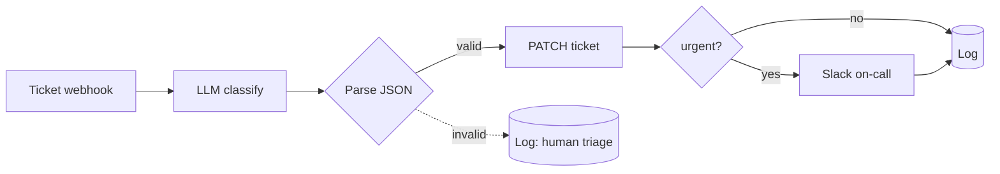

# AI Support Ticket Triage

> Every inbound ticket is read by an LLM, classified, prioritized, routed to the right team, and — if it's urgent — escalated to on-call in Slack, all before a human opens it.

## What it does

A new ticket hits the webhook. An LLM classifies it into a strict JSON schema (`category`, `priority`, `sentiment`, `suggested_team`, `summary`). The scenario **parses and validates** that JSON, writes the triage back onto the ticket, and alerts `#support-oncall` only when priority is `urgent`. If the model ever returns non-JSON, the ticket is logged for human triage instead of guessing.

## Trigger

**Instant webhook** from your help desk (Zendesk, Intercom, Freshdesk, custom).

## Apps & connections

| App | Module | Used for |
|---|---|---|
| Webhook | Custom webhook | Receive new ticket |
| OpenAI | Create chat completion | Classify the ticket |
| JSON | Parse JSON | Validate structured output |
| HTTP | PATCH ticket | Write triage back |
| Slack | Create message | Escalate urgent only |
| Data Store | Add record | Audit log |

> Swap the OpenAI module for the **Anthropic Claude** module if you prefer — the prompt and JSON contract are identical. The prompt is versioned in [`examples/prompts/support-triage.md`](../../examples/prompts/support-triage.md).

## Setup

| Setting | Where | Example |
|---|---|---|
| Model | Module 2 `model` | `gpt-4o-mini` (cheap, fast, accurate enough) |
| Temperature | Module 2 | `0` (deterministic classification) |
| Output format | Module 2 `response_format` | `json_object` |
| Escalation rule | Module 5 filter | `priority = urgent` |
| On-call channel | Module 5 | `#support-oncall` |

## Data flow

## Why structured output matters

The system prompt forces minified JSON with a fixed enum vocabulary, and the JSON parser is a hard gate: nothing acts on the model's output until it's been validated. A hallucinated free-text reply can't accidentally set a priority — it falls to the error path and a human. This is the single most important pattern in the `AI Agents/` category. See [docs/architecture.md → AI Agents](../../docs/architecture.md#ai-agents).

## Error handling & logging

- LLM call `Break`-retries 3× / 3 min (model endpoints rate-limit; short backoff).
- JSON parse failure logs `error` and `Resume`s → ticket stays for a human.
- Ticket update `Break`-retries; Slack `Resume`s. Every ticket gets one log row keyed by ticket id.
