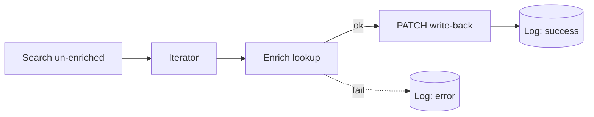

# CRM Contact Enrichment (scheduled write-back)

> Fill in job title, seniority, company size, and industry on contacts that are missing it — automatically, on a schedule.

## What it does

On a schedule, the scenario pulls a batch of **un-enriched** contacts from your CRM, looks each one up against an enrichment provider, and **writes the data back** to the CRM (flipping `enriched = true` so it's never processed twice). Every contact produces a log row; lookups that fail are logged as `error` and skipped without halting the batch.

## Trigger

**Scheduled** (e.g. every hour, or daily). Module 1 searches for work to do.

## Apps & connections

| App | Module | Used for | You provide |
|---|---|---|---|
| HTTP | Search un-enriched | Find contacts to enrich | CRM API key |
| Iterator | Basic feeder | Loop the batch | — |
| HTTP | Enrich lookup | Provider call (Clearbit/Apollo/etc.) | Enrichment API key |
| HTTP | PATCH contact | Write data back | CRM API key |
| HTTP | POST to log sink | Per-contact audit log | [Log sink](../../docs/log-sink.md) URL |

## Setup

| Setting | Where | Example |
|---|---|---|
| Batch size | Search body → `limit` | `50` |
| Enrichment provider | Module 3 `url` + key | Clearbit, Apollo, custom |
| Field mapping | Module 4 body | map provider fields → your CRM fields |
| Schedule | Scenario scheduling | every 1 hour |

## Data flow

## Error handling & logging

- Search + write-back use `onerror → Break` (retry 3×; write-back waits 10 min since CRM writes are heavier).
- The enrichment lookup catches its own error to a **log row** then `Resume`s — one bad lookup never kills the whole batch.
- `enriched = true` is the idempotency guard: re-runs skip already-processed contacts.
