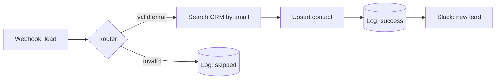

# Lead Capture → CRM (dedup + upsert)

> Turn any web form submission into a clean, de-duplicated CRM contact — with a logged audit trail and a Slack ping for the sales team.

## What it does

A form / landing page POSTs a lead to a Make webhook. The scenario validates the email, **searches the CRM for an existing contact**, then **upserts** (creates new or updates existing) so you never get duplicate records. Every run is logged, and valid new leads ping a Slack channel. Malformed submissions are rejected early and logged as `skipped`.

## Trigger

**Instant webhook** (`gateway:CustomWebHook`). Fires the moment your form submits.

## Apps & connections

| App | Module | Used for | You provide |
|---|---|---|---|
| Webhook | Custom webhook | Receive the lead | (auto URL) |
| HTTP | Make a request ×2 | Search + upsert in your CRM | Bearer API key |
| HTTP | POST to log sink ×2 | Audit log (success + skipped) | [Log sink](../../docs/log-sink.md) URL |
| HTTP | POST to Slack webhook | Notify sales | Slack incoming webhook URL |

> Every call is a generic **HTTP** module, so this works with any CRM (HubSpot, Pipedrive, Attio, custom) and any notifier. Swap an HTTP module for a native Make app module if you prefer.

## Setup

| Setting | Where | Example |
|---|---|---|
| CRM base URL | Both HTTP modules → `url` | `https://api.hubapi.com` |
| API key | HTTP headers → `Authorization` | `Bearer YOUR_CRM_API_KEY` |
| Match field | Upsert body → `matchField` | `email` |
| Log sink | Log POSTs → `url` | `https://YOUR_LOG_SINK/append` ([setup](../../docs/log-sink.md)) |
| Slack webhook | Notify module → `url` | `https://hooks.slack.com/services/…` |

## Test payload

```bash
curl -X POST "https://hook.us1.make.com/YOUR_WEBHOOK_ID" \
  -H "Content-Type: application/json" \
  -d '{
    "firstName": "Dana",
    "lastName": "Lopez",
    "email": "dana@acme.io",
    "company": "Acme",
    "source": "pricing-page"
  }'
```
Sample payloads: [`examples/payloads/lead.json`](../../examples/payloads/lead.json).

## Data flow



## Error handling & logging

- Both HTTP modules carry an `onerror → Break` (3 attempts, 5-min interval) so a transient CRM 5xx or rate-limit retries instead of dropping the lead.
- The Slack module uses `Resume` — if alerting fails, the lead is still saved and logged; we don't fail the whole run over a notification.
- Every path POSTs a structured row to the **log sink** (`success` or `skipped`), each guarded by `Resume` so logging never breaks the run.

See the [conventions](../../docs/conventions.md) for the shared standard.
