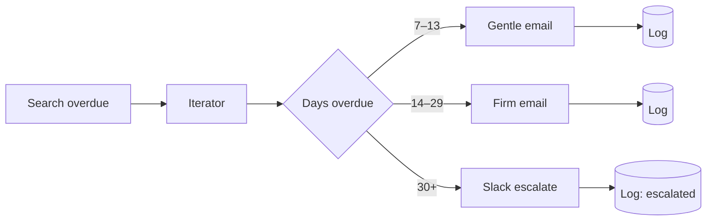

# Overdue Invoice Dunning (staged)

> A polite-but-persistent collections robot: escalates the tone as an invoice ages, and hands off to a human once automated reminders have done their job.

## What it does

Daily, it finds all open invoices past their due date and routes each one by **how overdue** it is:

| Age | Action | Tone |
|---|---|---|
| 7–13 days | Email reminder | Friendly nudge |
| 14–29 days | Email reminder | Firm, mentions late fee |
| 30+ days | Slack to finance team | Human escalation — stop emailing, start calling |

Every action is logged once per invoice per day.

## Trigger

**Scheduled** — daily (e.g. 09:00).

## Apps & connections

| App | Module | Used for |
|---|---|---|
| HTTP | Search invoices | Pull open overdue invoices |
| Iterator | Basic feeder | Loop invoices |
| Router | Basic router | Branch by age |
| Email | Send email | Stage 1 & 2 reminders |
| Slack | Create message | Stage 3 escalation |
| Data Store | Add record | Audit log |

## Setup

| Setting | Where | Example |
|---|---|---|
| Billing API | Module 1 | Stripe, QuickBooks, custom |
| Stage thresholds | Router filters | 7 / 14 / 30 days |
| Pay link | Email body `payUrl` | hosted invoice URL |
| Finance channel | Module 8 | `#finance` |

## Data flow

## Error handling & logging

- Search `Break`-retries 3× / 5 min.
- Each email `Break`-retries 3× / 10 min (SMTP can be flaky; longer backoff).
- Log key is `dun-<invoiceId>-<YYYYMMDD>` with `overwrite: true` — an invoice gets exactly one reminder per day, no matter how often the scenario runs.
- The `escalated` status lets you filter the log for invoices a human must chase.
