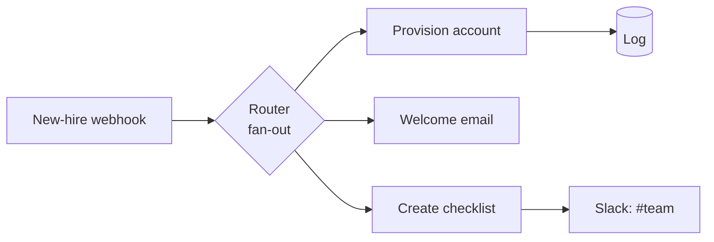

# New-Hire Onboarding (fan-out)

> One "new hire" event triggers everything at once — account provisioned, welcome email sent, manager's checklist created, and the team notified — in parallel.

## What it does

When HR adds a new hire (HRIS event or intake form), a router **fans the event out into three parallel branches**:

1. **Provision** an identity/account in your IdP (Google Workspace, Okta, Azure AD) → logged.
2. **Welcome email** to the hire's personal address with paperwork + handbook links.
3. **Onboarding checklist** assigned to the manager in your PM tool, then a `#team` announcement.

Because the branches are independent, a failure in one (say, the PM tool is down) doesn't block the others.

## Trigger

**Instant webhook** from your HRIS (Bamboo HR, Rippling) or a new-hire intake form.

## Apps & connections

| App | Module | Used for |
|---|---|---|
| Webhook | Custom webhook | Receive new-hire event |
| Router | Basic router | Fan out to 3 branches |
| HTTP | Create user | Provision IdP account |
| Email | Send email | Welcome message |
| HTTP | Create checklist | Manager onboarding tasks |
| Slack | Create message | Team announcement |
| Data Store | Add record | Audit log |

## Setup

| Setting | Where | Example |
|---|---|---|
| IdP API | Module 3 | Google Workspace / Okta |
| Groups | Module 3 body `groups` | `all-staff`, department |
| PM template | Module 6 `template` | `new-hire` checklist |
| Team channel | Module 7 | `#team` |

Expected webhook fields: `firstName, lastName, workEmail, personalEmail, role, department, startDate, managerName, managerEmail, docsUrl, handbookUrl`. Sample: [`examples/payloads/new-hire.json`](../../examples/payloads/new-hire.json).

## Data flow

## Error handling & logging

- Account provisioning and checklist creation `Break`-retry (10 / 5 min); the welcome email retries too.
- The Slack announcement `Resume`s — a missed announcement never blocks provisioning.
- Branches are independent: one failing app doesn't stall the rest of onboarding.
