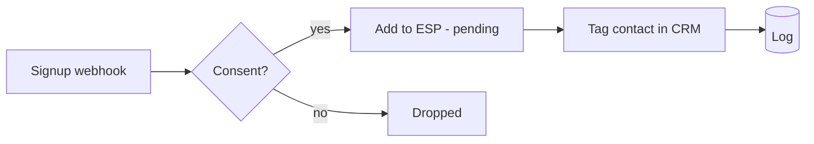

# Newsletter Signup Sync

> One signup, synced everywhere — your email platform *and* your CRM stay in lock-step, with consent respected via double opt-in.

## What it does

A signup form posts to the webhook. If the subscriber gave **consent**, the scenario adds them to your email platform with `pending` status (double opt-in), tags the matching contact in your CRM as a `newsletter-subscriber`, and logs the sync. No-consent submissions are filtered out before any write.

## Trigger

**Instant webhook** from your signup form / popup.

## Apps & connections

| App | Module | Used for |
|---|---|---|
| Webhook | Custom webhook | Receive signup |
| HTTP | Add subscriber | Email platform (Mailchimp/ConvertKit/Brevo) |
| HTTP | Upsert contact | Tag in CRM |
| HTTP | POST to log sink | Audit log |

## Setup

| Setting | Where | Example |
|---|---|---|
| List id | Module 2 `url` | your ESP audience/list id |
| Opt-in status | Module 2 body `status` | `pending` (double) or `subscribed` (single) |
| Consent field | Module 2 filter | `{{1.consent}} = true` |

## Data flow

## Error handling & logging

- Both writes `Break`-retry 3× / 5 min.
- The consent filter is the first gate — no consent, no write, by design.
- Each sync POSTs one log row carrying the email; the consent filter is the first gate, so only consented signups are ever processed. (Your log sink can dedupe by email if you want re-submits collapsed.)

> **Note:** Double opt-in (`pending`) is the default because it protects sender reputation and respects subscriber intent. Switch to single opt-in only if your platform/process requires it.
