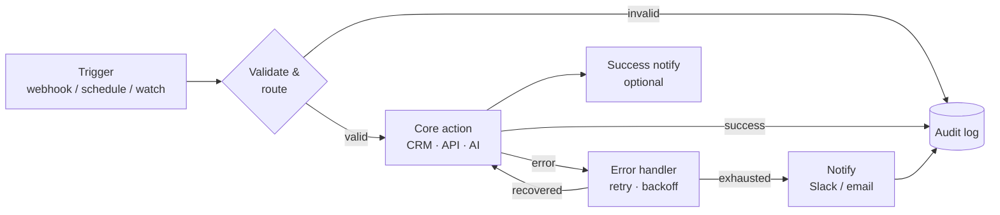

# 🔧 Make AI Automation Library

### Production-grade [Make.com](https://www.make.com) blueprints for CRM, Sales, Marketing, Finance, HR & AI agents

**Import-ready scenarios** — every blueprint ships with built-in **error handling, retries, logging, and notifications**, not just a happy path.

-blue?style=flat-square)

---

## What this is

A curated, **original** library of Make.com automation blueprints you can import and run in minutes. Each scenario is built the way real production automations should be — with retry logic on every fragile call, a logging trail you can audit, and failure notifications so you find out about breakage from Slack, not from an angry customer.

This is not a dump of happy-path demos. Every blueprint follows the same [engineering conventions](docs/conventions.md): consistent module IDs, an error-handling pattern, sanitized credentials, and a per-blueprint README that explains the data flow, the modules used, and the setup steps.

> **New to Make.com?** Start with [docs/getting-started.md](docs/getting-started.md) — it walks you from zero to your first imported scenario.

---

## 📁 Library map

| Category | What lives here | Blueprints |
|---|---|---|
| [**CRM/**](CRM/) | Lead capture, contact sync, deduplication, enrichment | [Lead Capture → CRM](CRM/lead-capture-to-crm/), [CRM Enrichment](CRM/crm-contact-enrichment/) |
| [**Sales/**](Sales/) | Deal lifecycle, meeting → deal, stale-pipeline nudges | [Meeting Booked → Deal](Sales/meeting-booked-to-deal/), [Stale Deal Reminder](Sales/stale-deal-reminder/) |
| [**Marketing/**](Marketing/) | List sync, content distribution, attribution | [Newsletter Signup Sync](Marketing/newsletter-signup-sync/) |
| [**AI Agents/**](AI%20Agents/) | LLM-powered triage, classification, content repurposing | [AI Support Triage](AI%20Agents/ai-support-ticket-triage/), [AI Content Repurposer](AI%20Agents/ai-content-repurposer/) |
| [**Finance/**](Finance/) | Invoicing, dunning, reconciliation reminders | [Overdue Invoice Dunning](Finance/overdue-invoice-dunning/) |
| [**HR/**](HR/) | Onboarding, PTO, document collection | [New-Hire Onboarding](HR/new-hire-onboarding/) |
| [**Utilities/**](Utilities/) | Reusable patterns: digests, health checks, dispatchers | [Daily Ops Digest](Utilities/daily-ops-digest/) |
| [**Shared Modules/**](Shared%20Modules/) | Drop-in error handler, logger & notifier snippets | [Reusable patterns](Shared%20Modules/) |
| [**docs/**](docs/) | Getting started, architecture, conventions, diagrams | — |
| [**examples/**](examples/) | Sample payloads, test data, AI prompt library | — |

---

## ✨ What makes these different

Every blueprint is built against five engineering standards. See [docs/conventions.md](docs/conventions.md) for the full spec.

| Standard | How it shows up in the blueprints |
|---|---|
| 🔁 **Retries** | Fragile API calls wrap a `Break` error handler with backoff (e.g. 3 attempts, 5-min interval) so transient failures self-heal. |
| 📜 **Logging** | Every run POSTs a structured row (timestamp, status, record id, message) to a single [log sink](docs/log-sink.md) audit trail. |
| 🔔 **Notifications** | Failures and key successes POST to a Slack (or Discord/Teams) incoming webhook so humans stay in the loop. |
| 🤖 **AI agents** | The `AI Agents/` category calls the LLM over HTTP with `response_format: json_object`, then validates with Make's `parseJSON()` (see [examples/prompts](examples/prompts/)). |
| 🧩 **Reusability** | Shared error-handler / logger / notifier patterns are documented once in [Shared Modules](Shared%20Modules/) and reused everywhere. |

> **Integration-agnostic by design.** Every external call is a plain HTTP module + Make's universal building blocks — so blueprints import into *any* Make account (no "Module Not Found"), and you point them at whatever CRM / LLM / notifier you use. [Why →](docs/conventions.md#0-integration-agnostic-by-design-http-first)

---

## 🚀 Quick start

1. **Open Make.com** → *Create a new scenario* → **⋯ menu → Import Blueprint**.
2. Pick any `blueprint.json` from a folder below (e.g. [`CRM/lead-capture-to-crm/blueprint.json`](CRM/lead-capture-to-crm/blueprint.json)). It imports with every module intact.
3. **Edit the placeholders** in each HTTP module — swap `https://YOUR_CRM_API/…` for your real endpoint, `Bearer YOUR_*_API_KEY` for your key, and `https://hooks.slack.com/services/REPLACE…` for your Slack webhook.
4. Set up the [log sink](docs/log-sink.md) once (a tiny Data Store / Sheet / Airtable scenario), and point `https://YOUR_LOG_SINK` at it.
5. Read that blueprint's `README.md` for fields + test payloads in [`examples/`](examples/). Run once with test data, confirm the log row + notification, then turn the schedule on.

Full walkthrough with screenshots: [docs/getting-started.md](docs/getting-started.md).

---

## 🗺️ Architecture at a glance

Every blueprint is a variation on this skeleton. Detailed diagrams per category live in [docs/architecture.md](docs/architecture.md).

---

## 🧭 Roadmap

This library is being built to **50+ blueprints**. Current focus:

- [x] Repo structure, conventions & shared patterns
- [x] First 10 reference blueprints across all 7 categories
- [ ] Expand CRM & Sales to 8 blueprints each
- [ ] Add Marketing attribution + multi-channel sequences
- [ ] AI Agents: RAG-backed responder, lead scorer, call-summary agent
- [ ] Finance: reconciliation, expense routing, MRR reporting
- [ ] Demo GIFs + import screencasts for each category

See [docs/roadmap.md](docs/roadmap.md) for the full backlog.

---

## 🤝 Contributing & license

Contributions welcome — see [CONTRIBUTING.md](CONTRIBUTING.md) for the blueprint checklist (every PR must meet the five standards above).

Licensed under the [MIT License](LICENSE). © 2026 Hamna.
If you reuse any third-party MIT-licensed blueprint, retain its original copyright notice alongside this one.

**Contact:** hamna.connect@gmail.com
