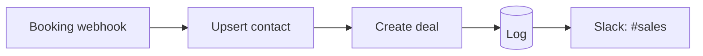

# Meeting Booked → Deal

> Every calendar booking instantly becomes a CRM contact + open deal, with the rep notified in Slack — no manual data entry between "they booked" and "it's in the pipeline."

## What it does

A booking tool (Calendly, Cal.com, HubSpot Meetings) fires a webhook. The scenario upserts the invitee as a contact, **creates a deal** at the `meeting-booked` stage assigned to the host, logs it, and posts to `#sales`.

## Trigger

**Instant webhook** from your booking tool's "invitee created" event.

## Apps & connections

| App | Module | Used for |
|---|---|---|
| Webhook | Custom webhook | Receive booking event |
| HTTP | Upsert contact | Create/match the invitee |
| HTTP | Create deal | Open the opportunity |
| Data Store | Add record | Audit log |
| Slack | Create message | Notify the rep |

## Setup

| Setting | Where | Example |
|---|---|---|
| Pipeline / stage | Module 3 body | `sales` / `meeting-booked` |
| Owner routing | Module 3 `ownerEmail` | `{{1.host.email}}` |
| Slack channel | Module 5 | `#sales` |

Map your booking tool's payload fields (`invitee.email`, `event.startTime`, `host.email`) to whatever your provider sends — see [`examples/payloads/booking.json`](../../examples/payloads/booking.json).

## Data flow

## Error handling & logging

- Contact upsert and deal creation both `Break`-retry 3× / 5 min on transient failure.
- Slack `Resume`s on failure — a missed notification never loses the deal.
- Deal id is the log key, so re-fires from a flaky webhook are easy to spot.
