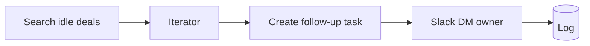

# Stale Deal Reminder

> Find open deals that have gone quiet and nudge the owner before the deal goes cold — a daily pipeline-hygiene robot.

## What it does

On a daily schedule, it searches for open deals with **no activity in 7+ days**, and for each one creates a follow-up task due tomorrow, DMs the owner in Slack, and logs the nudge (idempotent per day so an owner isn't pinged twice).

## Trigger

**Scheduled** — recommended daily at the start of the work day.

## Apps & connections

| App | Module | Used for |
|---|---|---|
| HTTP | Search deals | Find idle open deals |
| Iterator | Basic feeder | Loop the results |
| HTTP | Create task | Put a follow-up on the owner's list |
| Slack | Create message | DM the owner |
| Data Store | Add record | Audit log (dedup per day) |

## Setup

| Setting | Where | Example |
|---|---|---|
| Idle threshold | Module 1 `lastActivityBefore` | `addDays(now; -7)` |
| Task due date | Module 3 `dueDate` | tomorrow |
| Owner Slack id | `2.ownerSlackId` | map from your CRM |
| Schedule | Scenario scheduling | daily 08:00 |

## Data flow

## Error handling & logging

- Search + task creation `Break`-retry 3× / 5 min.
- Slack `Resume`s — a failed DM still leaves the task + log in place.
- Log key includes the date (`stale-<dealId>-YYYYMMDD`) with `overwrite: true`, so the same deal yields at most one reminder per day even if the scenario re-runs.
