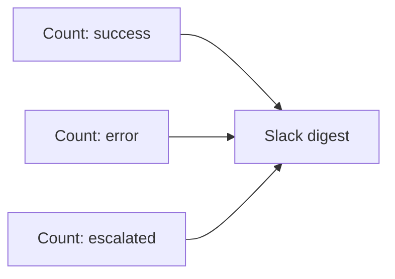

# Daily Ops Digest

> One Slack message every morning telling you how every other automation in this library performed overnight — successes, errors, escalations.

## What it does

This is the **observability layer** for the whole library. Every blueprint writes to a shared **Automation Log** Data Store; this scenario reads it once a day, counts runs by `status` over the last 24 hours, and posts a digest to `#ops`. If there were any errors, it tells you to go look; if not, it says all systems healthy.

It's also the **simplest blueprint to test first** — it only needs a Slack connection and the Data Store.

## Trigger

**Scheduled** — daily, first thing in the morning.

## Apps & connections

| App | Module | Used for |
|---|---|---|
| Data Store | Count records ×3 | Tally success / error / escalated |
| Slack | Create message | Post the digest |

## Setup

| Setting | Where | Example |
|---|---|---|
| Log store | All 3 count modules | Data Store `Automation Log` |
| Window | filter `timestamp` | `addDays(now; -1)` (24h) |
| Ops channel | Module 4 | `#ops` |
| Schedule | Scenario scheduling | daily 08:30 |

> The Data Store filters are set in each Count module. If your Data Store uses different field names than `status` / `timestamp`, adjust the filters after import.

## Data flow

## Why this matters for a portfolio

Most automation demos have no observability — you only find out something broke when a customer complains. This library is designed so that **every scenario logs to one place** and this digest surfaces it. It's the difference between "I built some automations" and "I run an automation *system*."

## Error handling & logging

- Count modules `Break`-retry briefly; the escalation count `Resume`s to `0` if that status has never been written yet (so the digest still sends on day one).
- The Slack post `Break`-retries 3× — the digest *is* the deliverable.
