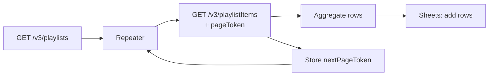

# Scrape Private YouTube Playlists

> Pull every video from a (private or public) YouTube playlist — paginating through the whole list — and write the rows into a Google Sheet.

## What it does

Calls the YouTube Data API (`/v3/playlists` and `/v3/playlistItems`), walks **every page** of results using the `nextPageToken` (stored in a variable and looped via a repeater), and appends the videos in bulk to a Google Sheet. Useful for archiving a playlist, building a content index, or feeding a downstream report.

## ⭐ Real-world blueprint

Unlike the other library scenarios (which are HTTP-first and integration-agnostic), this is an **actual exported scenario from a live Make account** — so it uses native Make modules and is verified to import as-is:

- `youtube:universal` — authenticated YouTube Data API calls
- `google-sheets:addMultipleRows` / `google-sheets:clearValuesFromRange` — bulk write + reset
- `util:SetVariable2` / `util:GetVariable2` — hold the pagination token across iterations
- `builtin:BasicRouter`, `builtin:BasicFeeder`, `builtin:BasicAggregator`, `builtin:BasicRepeater` — pagination loop control

It's included as a worked reference for the **pagination pattern** (token-in-a-variable + repeater), which the HTTP-first blueprints don't otherwise demonstrate.

## Trigger

**Scheduled** (`instant: false`). Run on demand or on a cadence.

## Setup

| Setting | Where | Notes |
|---|---|---|
| YouTube connection | `youtube:universal` modules | Reconnect your own Google/YouTube account |
| Google Sheets connection | `google-sheets:*` modules | Reconnect your own Google account |
| Spreadsheet | `spreadsheetId` (placeholder `YOUR_SPREADSHEET_ID`) | Point at your target sheet |
| Sheet name / range | Google Sheets modules | Match your tab + columns |
| Playlist | playlist id passed to `/v3/playlistItems` | Set the playlist you want to scrape |

> **Sanitized for the repo:** the real spreadsheet ID was replaced with `YOUR_SPREADSHEET_ID` and the connection email with `you@example.com`. Make strips credentials on export, so no tokens are present — you reconnect both Google connections after import.

## Data flow

## Hardening backlog (to meet library conventions)

This scenario is a candidate to bring up to the library's [five standards](../../docs/conventions.md):

- [ ] Add `onerror → Break` retries on the YouTube and Sheets calls (API quota / 5xx).
- [ ] POST a run row to the [log sink](../../docs/log-sink.md) on completion + failure.
- [ ] Notify on failure (Slack webhook).
- [ ] Guard the pagination loop against an unbounded run (max pages).

See the other Utilities blueprints for the patterns to copy.
