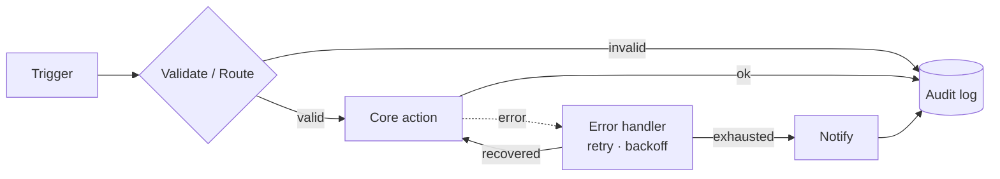
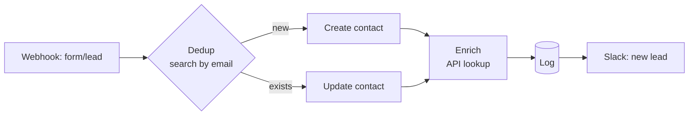
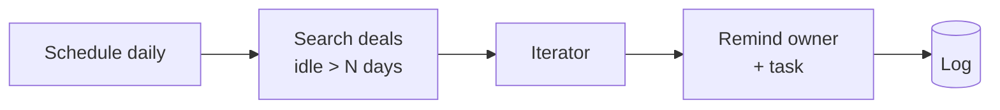
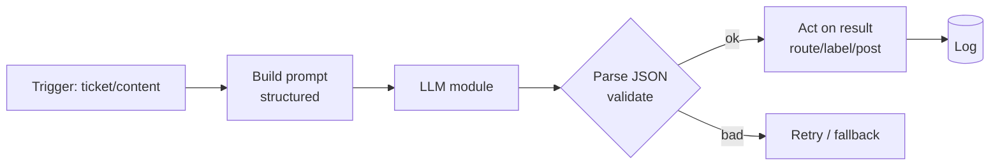
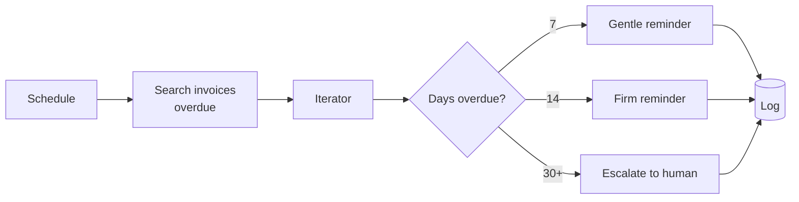

# Architecture

Every blueprint specializes one skeleton. Understanding the skeleton makes all 50+ scenarios readable at a glance.

---

## The universal skeleton

- **Trigger** — webhook (instant), schedule (polled), or app watch.
- **Validate / Route** — a `BasicRouter` + filters drop malformed data early and branch by type.
- **Core action** — the actual work: write a CRM record, call an LLM, send a dunning email.
- **Error handler** — `onerror` → `Break` with retry/backoff on every fragile module.
- **Log** — structured row to Data Store / Sheets, on every path.
- **Notify** — Slack/email on exhausted failure, optionally on key success.

---

## Category specializations

### CRM

Dedup-before-write is the defining move — never create duplicate contacts.

### Sales

Time-based pipeline hygiene: find stale records, nudge owners, log the nudge.

### AI Agents

Always request **structured output** and validate it before acting. The prompt lives in [examples/prompts](../examples/prompts/), versioned separately from the blueprint.

### Finance

Stage-based dunning: escalate tone with age, hand off to a human at the end.

### HR / Utilities
HR onboarding fans a single "new hire" event out to many parallel provisioning actions (accounts, docs, calendar) via a router. Utilities are reusable infra — digests, health checks, and the shared error-handler template every other category imports.

---

## Why this design

| Decision | Rationale |
|---|---|
| Router-first validation | Bad data never reaches an external write; cheap to reject early. |
| `onerror` on every API call | Transient cloud failures are *normal*; the scenario must absorb them. |
| Log on every path | You can answer "what happened to record X?" without re-running anything. |
| Notifications routed, not inline | Toggle alerting without editing core logic. |
| Prompts versioned outside JSON | Iterate on AI behavior without re-importing the whole scenario. |
